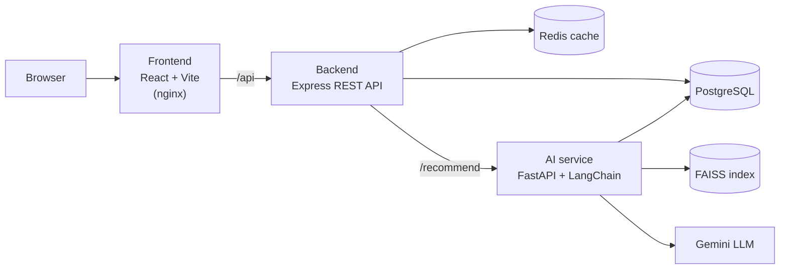

# 🍔 FoodHub — AI-Powered Food Delivery & Analytics Platform

[](https://github.com/PavanVibe/food_delivery/actions/workflows/ci.yml)

A full-stack food ordering platform that serves **personalised meal recommendations** with a RAG pipeline and gives restaurants an **operations dashboard** — from menu discovery and checkout to a live kitchen queue and sales analytics.

**React · Node.js/Express · FastAPI · PostgreSQL · Redis · LangChain · FAISS · JWT · bcrypt · Zod · Docker · GitHub Actions**

---

## Highlights

- **Three independently deployable services** — React frontend, Express REST API, FastAPI AI microservice — orchestrated with Docker Compose alongside PostgreSQL and Redis.
- **RAG recommendation engine** — menu items are embedded with `all-MiniLM-L6-v2` into a **FAISS** index via **LangChain**; at query time the top matches are re-read from PostgreSQL (live price/availability) and passed to Gemini as the only allowed context. Any dish id the LLM returns that wasn't retrieved is dropped, so answers stay grounded in the real menu.
- **Personalisation** — the customer's order history shapes the prompt, and a "For You" feed recommends untried dishes similar to their favourites (vegetarians stay vegetarian).
- **Express backend in MVC + Repository layers** — 30 REST endpoints, JWT auth with role-based access (customer / restaurant owner / admin), bcrypt hashing, Zod validation on every input, rate limiting, Helmet.
- **Redis read-through caching** for menus, restaurants, analytics and AI answers, with prefix invalidation on menu writes and graceful fallback when Redis is down.
- **PostgreSQL schema in 3NF** with targeted B-tree, partial, covering and trigram (GIN) indexes; seeded with **50,000+ orders / 100,000+ order items** for realistic analytics.
- **Restaurant dashboard** — revenue trend, peak hours, top dishes, status breakdown, and a live order queue with an enforced status state machine.
- **CI/CD** — GitHub Actions runs lint + unit tests for all three services, integration tests against real PostgreSQL + Redis, a query-latency report, Docker builds, and publishes images to GHCR on `master`.

## Architecture



### Recommendation flow (RAG)

1. **Index** — each dish becomes a LangChain `Document` (name, description, cuisine, diet, spice, nutrition, plain-language traits such as "high protein" or "budget friendly"), embedded into FAISS. The index is persisted with a fingerprint of the menu and rebuilt automatically when the menu changes.
2. **Retrieve** — the query is embedded and the nearest dishes are fetched with hard filters (veg-only, max price) applied inside the vector search.
3. **Ground** — retrieved ids are re-read from PostgreSQL so sold-out items or changed prices never reach the user.
4. **Generate** — a LangChain prompt → Gemini → `PydanticOutputParser` chain picks dishes and writes short reasons, using the customer's order history as context.
5. **Guard** — picks outside the retrieved set are discarded; if the LLM fails, times out, or no key is configured, the service falls back to retrieval-only ranking.

## Quick start (Docker)

```bash
git clone https://github.com/PavanVibe/food_delivery.git
cd food_delivery
cp .env.example .env        # optional: add GEMINI_API_KEY for LLM re-ranking
docker compose up --build
```

| Service | URL |
|---|---|
| Web app | http://localhost:8080 |
| REST API | http://localhost:5000/api/health |
| AI service docs | http://localhost:8000/docs |
| PostgreSQL | localhost:5433 (`foodhub` / `foodhub`) |

The database is created and seeded on first start (menu + 50K orders). Without a Gemini key the AI service still works in retrieval-only mode.

### Demo accounts

| Role | Email | Password |
|---|---|---|
| Customer (has order history) | `demo@foodhub.dev` | `Demo@123` |
| Restaurant owner | `owner@foodhub.dev` | `Owner@123` |
| Admin | `admin@foodhub.dev` | `Admin@123` |

## Local development

Prerequisites: Node 20+, Python 3.11+, PostgreSQL 14+, Redis (optional).

```bash
# 1. Database: creates the DB, schema, indexes and seed data
cd backend
cp .env.example .env          # set DB_* credentials
npm install
npm run db:setup              # add --skip-orders for a menu-only seed

# 2. Backend (http://localhost:5000)
npm run dev

# 3. AI service (http://localhost:8000)
cd ../ai-services
python -m venv .venv && .venv\Scripts\activate      # source .venv/bin/activate on macOS/Linux
pip install -r requirements.txt
cp .env.example .env          # same DB_* values, plus GEMINI_API_KEY
uvicorn app.main:app --reload --port 8000

# 4. Frontend (http://localhost:5173, proxies /api to the backend)
cd ../frontend
npm install
npm run dev
```

## API

All routes are prefixed with `/api`. Responses use `{ data, meta? }`; errors use `{ error: { code, message, details? } }`.

| Area | Method & path | Access |
|---|---|---|
| Health | `GET /health` | public |
| Auth | `POST /auth/register` · `POST /auth/login` · `GET /auth/me` | public / user |
| Menu | `GET /foods` (filters, sort, pagination) · `GET /foods/search` (fuzzy) · `GET /foods/:id` · `GET /categories` | public |
| Menu admin | `POST /foods` · `PATCH /foods/:id` · `DELETE /foods/:id` | owner of restaurant / admin |
| Restaurants | `GET /restaurants` · `GET /restaurants/:id` (with menu) · `GET /restaurants/mine` | public / staff |
| Cart | `GET /cart` · `POST /cart/items` · `PATCH /cart/items/:foodId` · `DELETE /cart/items/:foodId` · `DELETE /cart` | customer |
| Orders | `POST /orders` (checkout) · `GET /orders` · `GET /orders/:id` · `PATCH /orders/:id/cancel` | customer |
| Kitchen | `GET /orders/manage` · `PATCH /orders/:id/status` | owner / admin |
| AI | `POST /ai/recommend` · `GET /ai/for-you` | public / customer |
| Analytics | `GET /analytics/summary` · `/sales` · `/top-foods` · `/peak-hours` | owner (own restaurants) / admin |

Checkout locks the cart rows (`SELECT … FOR UPDATE`), re-prices every item from the database, splits the cart into one order per restaurant and writes everything in a single transaction. Order status follows `pending → confirmed → preparing → out_for_delivery → delivered` (or `cancelled`), enforced server-side with compare-and-set updates.

## Database design

```
users ─┬─< restaurants ─< foods >─ categories
       ├─< cart_items >──────┘
       └─< orders ─< order_items >─ foods
```

- Prices are snapshotted on `order_items.unit_price`, so history never changes when a menu price does.
- Key indexes: `orders(user_id, created_at DESC)` for order history, `orders(restaurant_id, created_at DESC)` for dashboards, a covering `orders(created_at) INCLUDE (…)` for analytics, a partial index on live orders for the kitchen queue, and a `pg_trgm` GIN index for typo-tolerant search ("panner" finds "Paneer").
- `npm run benchmark` (in `backend/`) times the hot queries against the seeded 50K-order dataset; CI prints this report on every run.

## Testing

| Service | Command | What it covers |
|---|---|---|
| Backend | `npm test` | 51 unit tests: auth, validation, RBAC, cart pricing, checkout, state machine, analytics scoping, AI proxy |
| Backend | `npm run test:integration` | full customer → kitchen flow against real PostgreSQL |
| AI service | `pytest` | retrieval, filters, hallucination guard, LLM fallback, personalisation, index staleness, API |
| Frontend | `npm test` | protected routes, login flow, add-to-cart, formatting |

## Project structure

```
food_delivery/
├── backend/            Express API — src/{routes,controllers,services,repositories,validators,middleware}
├── ai-services/        FastAPI + LangChain — app/{main,menu,schemas}, app/rag/{documents,vector_store,chain,recommender}
├── frontend/           React + Vite — src/{pages,components,context,api}
├── database/init/      schema, indexes, seed menu, 50K-order generator
├── docker-compose.yml
└── .github/workflows/  CI/CD pipeline
```

## License

MIT
